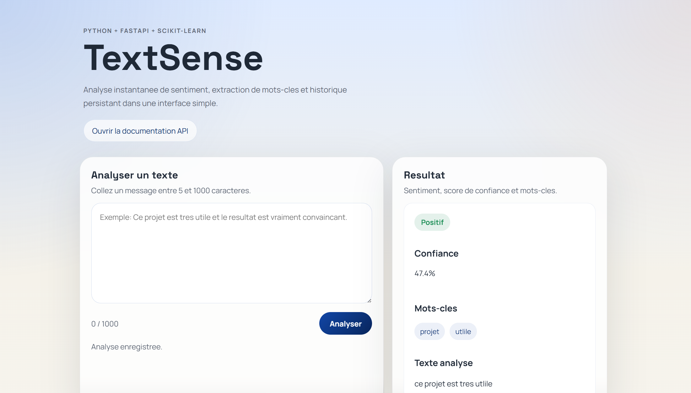
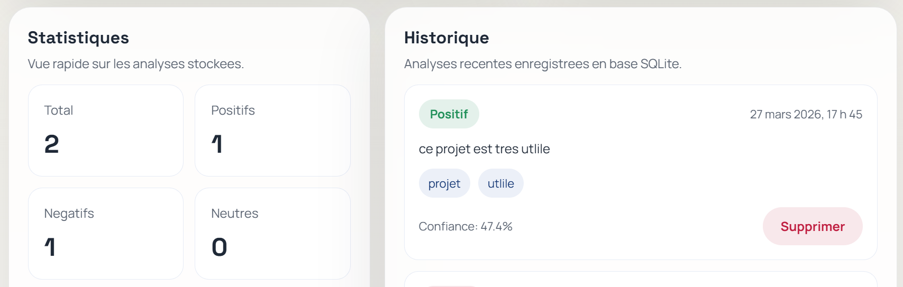

# TextSense

TextSense est une application web et une API REST d'analyse de texte construite avec Python, FastAPI, SQLite et JavaScript. Le projet permet de soumettre un texte, d'estimer son sentiment, d'extraire quelques mots-cles, d'enregistrer le resultat en base de donnees et de consulter l'historique depuis une interface web simple.

## Etat du projet

Le projet est fonctionnel mais encore en cours d'amelioration.

- L'application utilise actuellement un modele preentraine pour l'analyse de sentiment.
- Un modele maison plus simple, base sur `scikit-learn`, reste present comme solution de secours.
- Les resultats sont utiles pour une demonstration technique, mais ils ne sont pas encore optimaux sur toutes les phrases courtes, ambigues ou tres contextuelles.
- L'objectif a terme est de construire progressivement un modele davantage adapte au projet et aux exemples utilises.

## Fonctionnalites

- Analyse de sentiment: `positive`, `negative`, `neutral`
- Score de confiance associe a la prediction
- Extraction simple de mots-cles
- Historique des analyses en base SQLite
- Suppression d'une analyse enregistree
- Statistiques simples sur les analyses effectuees
- Interface web connectee a l'API
- Documentation Swagger disponible via `/docs`

## Technologies

- Python 3
- FastAPI
- Uvicorn
- SQLAlchemy
- SQLite
- Hugging Face Transformers
- scikit-learn
- HTML / CSS / JavaScript

## Modele de sentiment

Le projet utilise en priorite le modele preentraine `cmarkea/distilcamembert-base-sentiment` via Hugging Face Transformers.

Ce choix permet d'obtenir une base plus solide qu'un petit jeu de donnees manuel. Le modele est telecharge localement lors de la premiere utilisation, puis reutilise depuis le cache local de la machine.

Le projet conserve aussi un modele de secours entraine localement avec `TF-IDF + LogisticRegression`. Ce modele n'est pas le moteur principal de l'application, mais il reste utile comme baseline technique et comme solution de repli.

## Limites actuelles

- Certaines phrases tres courtes comme `je sors` ou `je viens` ne portent pas de sentiment clair.
- Le modele preentraine reste generaliste et n'est pas specifique a ce projet.
- L'extraction de mots-cles est volontairement simple et basee sur des regles.

Ces limites sont connues et font partie des prochaines evolutions du projet.

## Structure du projet

```text
TextSense/
|-- app/
|   |-- main.py
|   |-- routes.py
|   |-- models.py
|   |-- database.py
|   |-- schemas.py
|   |-- ml/
|   |   |-- train_model.py
|   |   |-- predictor.py
|   |   `-- keyword_extractor.py
|   |-- static/
|   |   |-- style.css
|   |   `-- script.js
|   `-- templates/
|       `-- index.html
|-- data/
|   `-- sentiment_dataset.csv
|-- saved_models/
|-- screenshots/
|   |-- home.png
|   `-- result.png
|-- tests/
|   |-- conftest.py
|   `-- test_api.py
|-- requirements.txt
|-- pytest.ini
`-- README.md
```

## Installation

Clonez le depot puis creez un environnement virtuel.

```bash
python -m venv venv
```

Windows:

```bash
venv\Scripts\activate
```

Linux / macOS:

```bash
source venv/bin/activate
```

Installez ensuite les dependances:

```bash
pip install -r requirements.txt
```

## Lancer le projet en local

Depuis la racine du projet:

```bash
uvicorn app.main:app --reload
```

Puis ouvrez:

- Interface web: `http://127.0.0.1:8000/`
- Documentation API: `http://127.0.0.1:8000/docs`

## Premier lancement

Lors du premier lancement, si le modele preentraine n'est pas encore present localement:

- il sera telecharge automatiquement
- cela peut prendre un peu de temps selon la connexion
- les lancements suivants seront plus rapides

Si le modele preentraine n'est pas disponible, l'application peut utiliser le modele de secours `scikit-learn` deja prevu dans le projet.

## Entrainement du modele de secours

Le projet contient aussi un script d'entrainement pour le modele local de baseline:

```bash
python app/ml/train_model.py
```

Ce script genere:

- `saved_models/sentiment_model.pkl`
- `saved_models/vectorizer.pkl`

## Endpoints principaux

- `POST /analyze`
- `GET /history`
- `GET /analysis/{id}`
- `DELETE /history/{id}`
- `GET /stats`

Exemple de requete:

```bash
curl -X POST http://127.0.0.1:8000/analyze ^
  -H "Content-Type: application/json" ^
  -d "{\"text\":\"Je suis tres content aujourd'hui\"}"
```

Exemple de reponse:

```json
{
  "id": 1,
  "text": "Je suis tres content aujourd'hui",
  "sentiment": "positive",
  "confidence": 0.97,
  "keywords": ["content", "aujourd'hui"],
  "created_at": "2026-03-27T10:15:00.000000"
}
```

## Tests

Pour executer les tests:

```bash
pytest -q tests
```

## Captures d'ecran

### Accueil



### Resultat d'analyse



## Auteur

Ahamed Tidiane Tall
